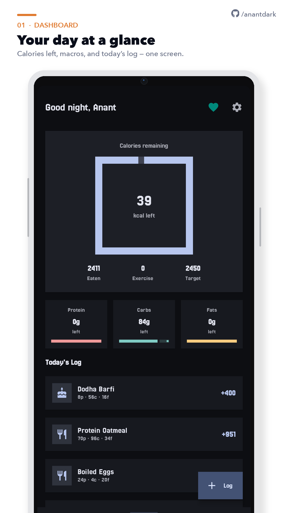
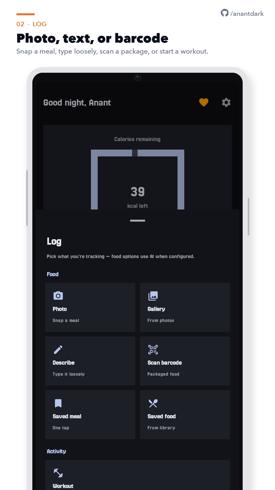
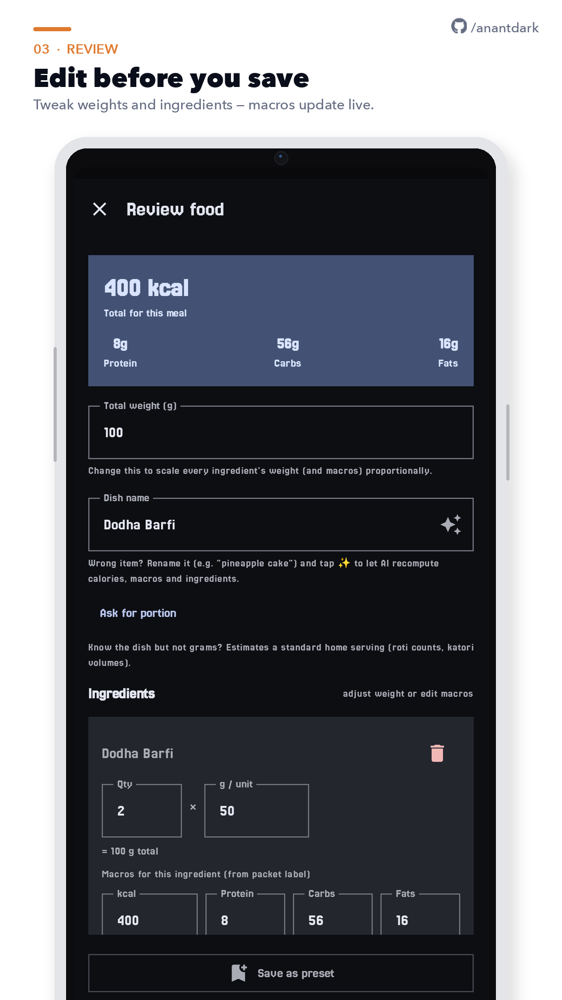
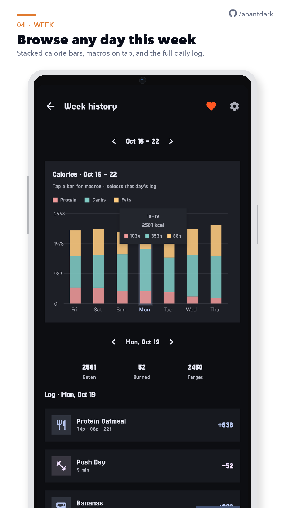
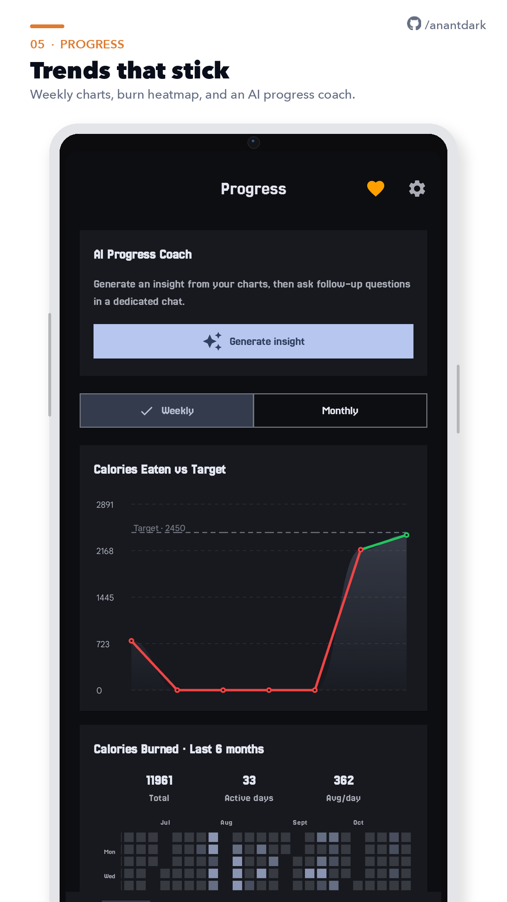
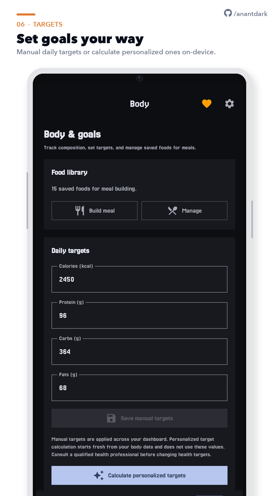
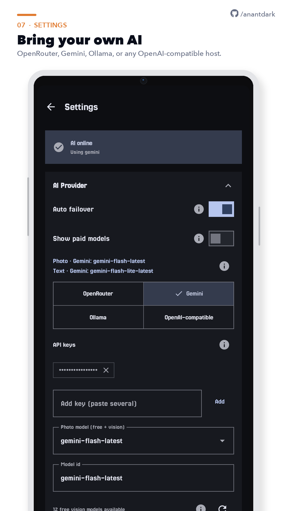

<p align="center">
  
</p>

<p align="center">
  <strong>AI-powered health tracker for Android</strong><br />
  Region-aware diets · photo / text / barcode logging · on-device privacy
</p>

<p align="center">
  <a href="https://github.com/anantdark/FitBuddy/actions/workflows/ci.yml"></a>
  <a href="https://github.com/anantdark/FitBuddy/actions/workflows/release.yml"></a>
  <a href="https://github.com/anantdark/FitBuddy/releases/latest"></a>
  <a href="LICENSE"></a>
  <a href="https://github.com/sponsors/anantdark"></a>
</p>

<p align="center">
  <a href="https://github.com/anantdark/FitBuddy/releases/latest"></a>
  &nbsp;
  <a href="https://f-droid.org/en/packages/com.anant.fitbuddy/"></a>
  &nbsp;
  <a href="https://www.openapk.net/fitbuddy/com.anant.fitbuddy/"></a>
</p>

<p align="center">
  <a href="https://www.androidfreeware.net/download-fitbuddy-apk.html"></a>
  &nbsp;
  <a href="https://anantdark.github.io/FitBuddy/"></a>
</p>

---

## Screenshots

<table>
  <tr>
    <td width="25%"></td>
    <td width="25%"></td>
    <td width="25%"></td>
    <td width="25%"></td>
  </tr>
  <tr>
    <td width="25%"></td>
    <td width="25%"></td>
    <td width="25%"></td>
    <td width="25%"></td>
  </tr>
</table>

Snap a plate or type what you ate — FitBuddy estimates calories and macros, then lets you edit before you save. Workouts, week history, progress charts, and bring-your-own AI are built in.

## Features

| | |
|---|---|
| **Region packs** | Personalise AI prompts, staples, portion language, and log examples to your region |
| **Smart logging** | Photo, loose text, or barcode — AI parses food and exercise |
| **Meal review** | Edit dish name and ingredient weights with live macro recalc |
| **Workouts** | Structured sessions, 1,500+ catalog moves with GIFs, AI-suggested names |
| **Presets** | Bookmark meals for one-tap logging |
| **Dashboard** | Daily calorie ring, food/exercise log, macro breakdown |
| **Body goals** | Weight, body fat, BMR, muscle mass; science-based targets — [methodology](docs/health-target-methodology.md) |
| **Analytics** | Custom Canvas charts; rolling 30-day window |
| **Encrypted backups** | AES-256-GCM local export + optional cloud |
| **Offline fallback** | Works without AI config via built-in simulator |
| **Crash reports** | Optional anonymous Sentry (opt out in Settings) |
| **Material You** | Dynamic color on Android 12+ |

## Download

| Channel | Notes |
|---------|--------|
| **[GitHub Releases](https://github.com/anantdark/FitBuddy/releases/latest)** | Latest APK (`FitBuddy-latest.apk`), arm64-v8a. Auto-built on every push to `main`. |
| **[F-Droid](https://f-droid.org/en/packages/com.anant.fitbuddy/)** | Same codebase, `fdroid` flavor, different signing key |
| **[OpenAPK](https://www.openapk.net/fitbuddy/com.anant.fitbuddy/)** | Mirror of the open-source build |

> F-Droid and GitHub use **different signing keys** — pick one channel per install; don’t mix updates.

## AI providers

Configure at runtime in **Settings** (DataStore, on-device):

| Provider | Notes |
|----------|-------|
| **OpenRouter** | Free vision models; optional account sign-in |
| **Gemini** | Google AI Studio key; OpenAI-compatible endpoint |
| **OpenAI** | Direct API key; curated gpt-4o catalog |
| **Ollama / compatible** | Local or cloud; LM Studio, vLLM, LocalAI, etc. |

First-run defaults can be seeded from `local.properties`. Without a key, the offline simulator handles text logs.

## Crash reporting

Anonymous crashes go to [Sentry](https://sentry.io) via FitBuddy’s ingest. **Not sent:** meals, photos, names, API keys. Opt out under **Settings → Crash reports**. Privacy & deletion: [privacy page](https://anantdark.github.io/FitBuddy/privacy.html) · `fitbuddy31@proton.me`.

## Build from source

**Requirements:** JDK 21 · Android SDK (compile API 36.1 / min 29) · macOS/Linux/WSL

```bash
git clone https://github.com/anantdark/FitBuddy.git
cd FitBuddy
cp local.properties.example local.properties   # set sdk.dir (+ optional AI keys)

export JAVA_HOME=/opt/homebrew/opt/openjdk@21/libexec/openjdk.jdk/Contents/Home  # macOS Homebrew
./gradlew :app:compileDebugKotlin
./gradlew :app:testDebugUnitTest
```

Release builds use R8 + resource shrink. Local `keystore.properties` should point at a **dev** keystore ([DISTRIBUTION.md](DISTRIBUTION.md)) — not the CI release key.

```bash
./gradlew :app:assembleRelease
adb install -r --user 0 app/build/outputs/apk/release/FitBuddy-*.apk
```

## Project structure

```
app/src/main/java/com/anant/fitbuddy/
├── FitBuddyApp.kt          # Application / manual DI
├── data/
│   ├── database/           # Room entities & DAOs
│   ├── model/              # API & domain models
│   ├── remote/             # Retrofit, AI prompts, DTOs
│   ├── repository/         # Business logic
│   └── settings/           # DataStore preferences
├── ui/
│   ├── screens/            # Compose screens
│   ├── viewmodel/          # MainViewModel
│   └── components/         # Charts, snackbar, etc.
└── util/                   # DateUtils, ImageUtils
```

Architecture: **MVVM** — UI → ViewModel → Repository → Room + Remote AI.

## CI / CD

| Workflow | Trigger | What it does |
|----------|---------|--------------|
| [CI](.github/workflows/ci.yml) | Push & PR to `main` | Compile debug/release, unit tests |
| [Release](.github/workflows/release.yml) | Push to `main` | Signed APK + AAB → GitHub Release |
| [F-Droid Release](.github/workflows/fdroid-release.yml) | Manual dispatch | Bump version, tag, publish fdroid flavor |

CI release signing needs `RELEASE_KEYSTORE_BASE64`, `RELEASE_STORE_PASSWORD`, `RELEASE_KEY_ALIAS`, and `RELEASE_KEY_PASSWORD` — see [DISTRIBUTION.md](DISTRIBUTION.md).

## Contributing

1. Fork and create a feature branch  
2. Run `./gradlew :app:compileDebugKotlin :app:testDebugUnitTest`  
3. Open a PR against `main` — CI must pass  

Bug reports and ideas: [Issues](https://github.com/anantdark/FitBuddy/issues).

## Supporters

Named public supporters appear here and as flip trading cards in the app (and on the [docs site](https://anantdark.github.io/FitBuddy/#supporters)). Donation amounts stay private.

<table>
  <tr>
    <td align="center" valign="top" width="260">
      <a href="https://www.instagram.com/philautian_art/">
        
      </a>
      <br />
      <strong>PHILAUTIAN</strong>
      <br />
      <code>No. 1001 · OG SUPPORTER</code>
      <br />
      <sub>FitBuddy · Origin circle</sub>
      <br />
      <sub>⚔ OG Supporter</sub>
    </td>
  </tr>
</table>

Thank you for keeping FitBuddy free and open. Roster: [`config/donors.json`](config/donors.json).

## Support development

[GitHub Sponsors](https://github.com/sponsors/anantdark) · in-app heart button (UPI/card for Indian users). Named gifts can unlock a public thank-you card.

## License

GPL-3.0 — see [LICENSE](LICENSE).

## Related docs

- [FDROID.md](FDROID.md) — F-Droid release process  
- [DISTRIBUTION.md](DISTRIBUTION.md) — Play Store & keystore  
- [Health target methodology](docs/health-target-methodology.md)  
- [AGENTS.md](AGENTS.md) — architecture notes for contributors  
- [Docs site](https://anantdark.github.io/FitBuddy/) — onboarding, guide, encryption, FAQ, privacy  
