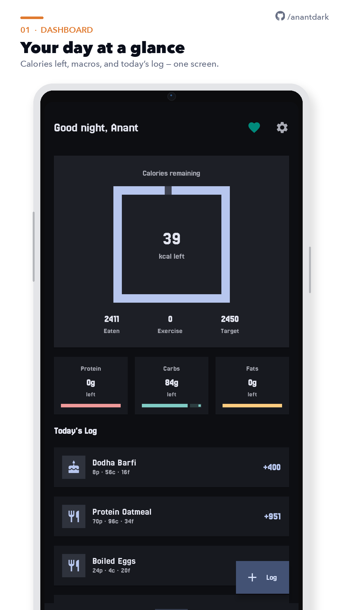
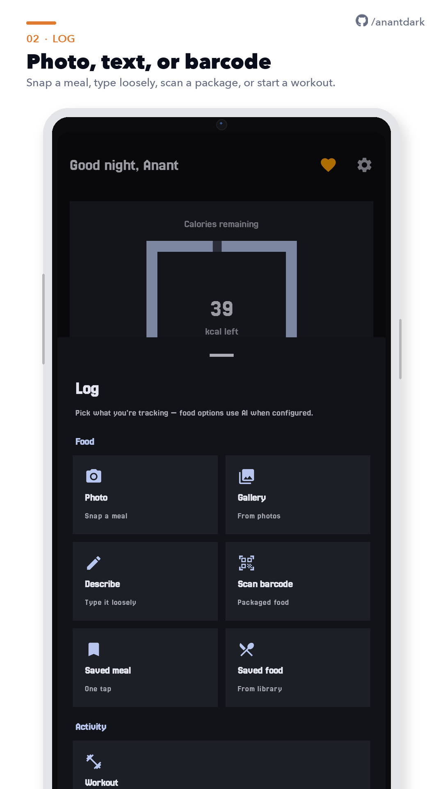
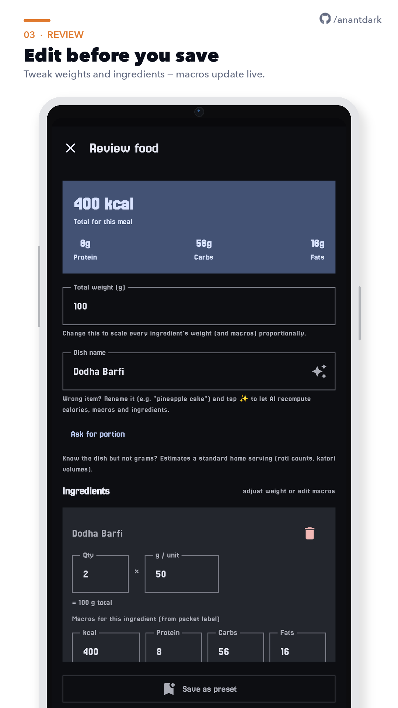
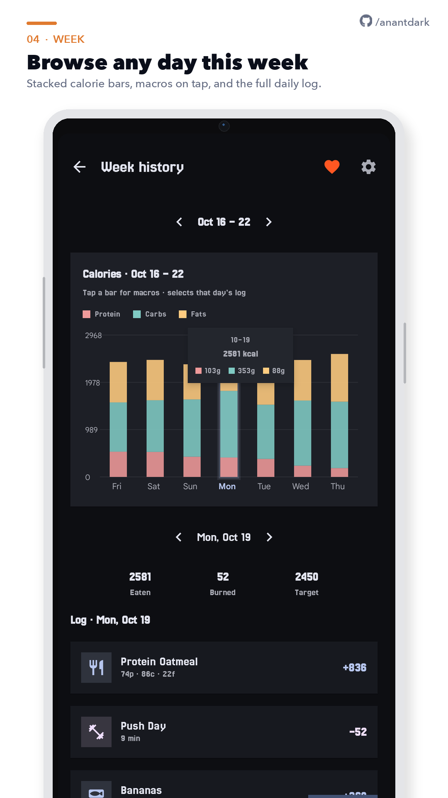

  

  <strong>AI-powered health tracker for Android</strong> 
  Region-aware diets · photo / text / barcode logging · on-device privacy

  
  
  
  
  
  

  
  &nbsp;
  
  &nbsp;
  

## Screenshots

<table>
  <tr>
    <td width="25%"></td>
    <td width="25%"></td>
    <td width="25%"></td>
    <td width="25%"></td>
  </tr>
</table>

## Supporters

<table>
  <tr>
    <td align="center" valign="top" width="260">
      
       
      <strong>PHILAUTIAN</strong>
       
      <code>No. 1001 · OG SUPPORTER</code>
    </td>
    <td align="center" valign="top" width="260">
      
       
      <strong>CLOXER</strong>
       
      <code>No. 1002 · OG SUPPORTER</code>
    </td>
    <td align="center" valign="top" width="260">
      
       
      <strong>ABHI</strong>
       
      <code>No. 1003 · OG SUPPORTER</code>
    </td>
  </tr>
</table>

[Docs supporters](https://anantdark.github.io/FitBuddy/#supporters) · [GitHub Sponsors](https://github.com/sponsors/anantdark) · [Telegram](https://t.me/fitbuddyapp)

## Translating

UI strings are translated on [Hosted Weblate](https://hosted.weblate.org/projects/fitbuddy/fitbuddy/).
See [docs/TRANSLATING.md](docs/TRANSLATING.md) for translator and maintainer instructions.

  

## Star History

GPL-3.0 — see [LICENSE](LICENSE).
